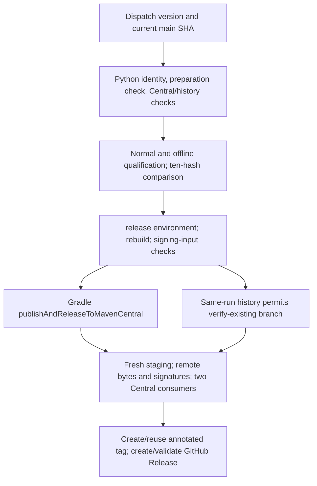
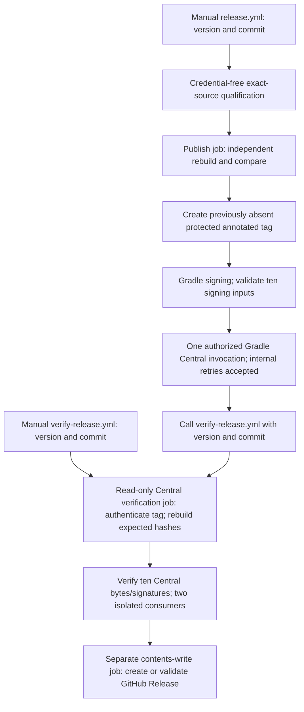

# J4S — Release process simplification

## Executive summary

**Design amended with the owner-proposed invocation-level policy, subject to owner approval of this report. The transport-related design blocker is resolved under that proposed policy; implementation and operational activation remain unauthorized.** The workflow-level design is substantially smaller: one manual dispatch, qualification, first-time protected tag creation, one Gradle publication invocation, independently repeatable verification, then automatic GitHub Release creation. GitHub Actions can replace the Java coordinator entirely. A release tag becomes a permanent reservation of a version, even when publication never starts.

Totipo can provisionally delete **10 of 25 release-package production Java files (698 lines)**, all **four operational Python files (754 lines)**, **three Python test files (717 lines)**, and **six migration oracles plus five oracle bridges (1,373 lines)**. Additional simplification of remaining Java classes/tests should remove roughly 500–850 lines gross. After approximately 250–450 lines of focused adapters and regression checks, the estimated net reduction is **4,000–4,600 lines** across production, tests and migration scaffolding. These are planning estimates, not an implemented diff. Independent publication/wrapper verification, test accounting, signing-input checks and remote-byte verification survive.

**Explicit answer:** most custom recovery/orchestration machinery can go while a normal release remains fully automatic after one dispatch. The proposed publication guarantee is **one authorized Gradle publication invocation per release version, not exactly-once HTTP transmission**. Successful preflight and first-time protected tag reservation authorize at most one execution of the Central publication operation. Existing tags block later ordinary publication dispatches, regardless of run number or Central availability; failure, cancellation, timeout or ambiguity never authorizes a second invocation. Verification-only recovery remains allowed. Vanniktech 0.37.0 and its pinned OkHttp 5.1.0 may retransmit an upload within that single invocation; this dependency behavior is explicitly accepted under the proposed policy. This does not prove exactly-once delivery or harmless/idempotent retransmission. Ambiguous or duplicate deployment outcomes require maintainer investigation, with no automatic repair.

J4S stops with this report for owner review. No additional HTTP retry suppression, custom uploader, interceptor, patched publishing dependency or retry-control infrastructure is required or proposed. Owner approval of the report, explicit J4B authorization, complete implementation qualification and the documented repository-settings prerequisites remain necessary; operational activation requires separate explicit authorization. No unperformed check is claimed as passed.

## 1. Baseline, scope and evidence

| Item | Observed value |
| --- | --- |
| Branch | `main` |
| Full starting/final HEAD | `40594af782c74b4ef95d573b62688e42bd4bae38` |
| Initial `git status --short` | Empty, including untracked files |
| Current `VERSION` | `0.2.0` followed by LF |
| Specification | Totipo v1/r19, commit `cdb4e91be1c6d3704874b2b92457ffe7be5e9084` |
| Requirements profile SHA-256 | `7242fc557a7ca56452c934bedc5e7dc2835248f5cd36fa220f05588dc967ec80` |
| Snapshot | 99 pinned upstream files, 92 portable cases |
| Existing workflows | `.github/workflows/ci.yml`, `.github/workflows/release.yml`; no verify workflow |
| J4A commit | Current HEAD; `git log -1 -- review/J4A_JAVA_RELEASE_WORKFLOW_INTEGRATION_REPORT.md` identifies it |
| Milestone classification | Excluded Markdown design/process report; subject is RELEASE_TOOLING, with no executable change; NOT RELEASE_PREPARATION or DEPENDENCY_BUILD |

Read `AGENTS.md` completely. Consulted the J2B, J3A, J3B.1, J3B.2 and J4A reports, actual Java release/publication/wrapper code and tests, Python controller/verifiers, workflows, consumers, root/module Gradle configuration, README, checklist and Nix definitions. Historical reports' “uncommitted” statements describe their own handoffs; tracked presence and current history establish that J4A is now committed. J4A intentionally left Python and the protected workflow authoritative. Its coordinator is an offline simulation API, unreachable from the installed CLI.

Only this repository was inspected. No siblings, worktrees or sub-agents. No build, test, Nix, signing, publication, tag mutation, workflow dispatch, GitHub Release creation, commit or push was executed. Read-only public HTTP requests inspected official documentation/upstream pinned source and this repository's public settings. No credentials were acquired or printed.

`qualification.nix` selects `core/src`, `storage-nio/src`, `gradle`, `publishing`, `nix` and an explicit root/module file list; it excludes `review/`. `nix/tooling.nix` selects Java under `tooling/src` plus SPEC_PIN/snapshot fixtures. `nix/wrapper-verifier.nix` selects wrapper/verifier inputs. `flake.nix` references those derivations, fixed cache and locked inputs, with no report consumption. This excluded report needs no Java or Nix qualification.

### Report-only clarification baseline

The clarification starts from `main` at the same full HEAD above with exactly this existing uncommitted report, already intent-to-add. Initial `git status --short --untracked-files=all` is ` A review/J4S_RELEASE_PROCESS_SIMPLIFICATION_REPORT.md`; `git diff --name-only` lists only that path; `git diff --cached --name-only` is empty. There are no other modifications or nonignored untracked files. The original J4S clean baseline in the table remains historical evidence; a clean tree is not required for this clarification. Read AGENTS.md and the current report again. Only this report is amended; prior research findings are retained without new remote checks.

## 2. Current workflow and actual responsibilities



Current dispatch must select main and its SHA must equal the requested SHA. Identity repeatedly requires fresh current main to remain exactly that commit. Preflight rejects existing tag/release. Two Central POM probes and same-run prior-attempt history produce `publish`/`verify`. Publication job rechecks observations and rebuilds against the preflight inventory, signs and checks all ten inputs, then invokes Gradle. Verification rebuilds and compares to an ephemeral preflight output. Tag creation happens **after** Central verification, so it is not presently a durable publication reservation.

CI runs the Python workflow-pin subset, installs pinned install-nix-action, and runs Nix qualification. Current protected release jobs use setup-java/JDK 25 and Python; they do **not** install Nix. Existing Gradle staging/publication checks remain independent of producers; standalone Java tooling is compiled by Nix with only pinned Jackson Core, independently of Gradle and production classes.

## 3. Proposed two-workflow architecture



Actions enforces at most one authorized Gradle publication invocation per version. The existing plugin may transmit the upload more than once within that invocation; its internal retries do not create permission for another workflow invocation. No workflow-level retry or automatic upload recovery is allowed.

Use `workflow_call` **and** `workflow_dispatch` on `verify-release.yml`, each with required string `version` and `commit`. The caller uses the relative workflow path from the same workflow commit; inputs are passed explicitly, no `secrets: inherit`, no Maven/signing secrets declaration, and no publication inventory is required from the original run. Reusable-workflow permissions cannot exceed the caller's permission ceiling; grant the call job `contents:write`, then explicitly downscope the called verification job to `contents:read` and reserve write access for its final job. Ordinary workflow defaults stay read-only. [GitHub reuse documentation](https://docs.github.com/en/actions/how-tos/reuse-automations/reuse-workflows), [permission/relative-path contract](https://docs.github.com/en/actions/reference/workflows-and-actions/reusing-workflow-configurations).

Automatic continuation uses `needs: publish-central` and ordinary success propagation. Do not use `always()`, `continue-on-error` or history-based continuation after upload failure. A plugin timeout requires investigation then explicit verification dispatch, even if Central later succeeds. `workflow_run` would require additional run/source authentication and is unnecessary; automatic workflow dispatch would need extra permissions and dispatch tracking. A reusable call is simpler and synchronous.

The verifier is a separately reviewable workflow with no release environment, no Central/signing secret references, no `centralRelease=true`, no generic publishing task, no preparation apply, no tag-create/update/delete command and no callable Java publication controller. Its only Gradle commands are an explicit unsigned staging/verification task and the two existing remote consumer modes. The unsigned producer necessarily stages Maven files locally; this is distinct from a Central uploader. Keep Central tasks unavailable in ordinary configuration. This is a structural command/credential boundary, not a comment promising restraint.

## 4. Exact successful sequence and source eligibility

1. Maintainer prepares VERSION, consumer self-lock coordinates, reviewed version-specific notes and intended source; reviews and commits through normal review. CI succeeds. Preparation is source editing, not publication authority.
2. Dispatch `release.yml` on main with version and exact 40 lowercase hex commit. Validate grammar before using input as checkout/ref/argument; interpolate only through quoted environment variables.
3. Require dispatch SHA = requested SHA at entry, HEAD = requested SHA, exact VERSION/LF, clean checkout, complete reviewed notes with required sections/no TODO, exact SPEC_PIN and full snapshot integrity. Initially reject any existing version tag or GitHub Release. Canonical Central POM probes must both return 404; errors stop. These probes are a veto, never upload authority.
4. Bootstrap the same pinned tools from the reviewed commit. Verify wrapper identity before wrapper execution. Run permanent tooling guardrails, normal full qualification and immediate accounting, then forced-offline full qualification and immediate accounting. Independently verify both stagings and compare exactly ten path/hash pairs. Retain local module and POM-only consumer checks, Java 17 bytecode, focused snapshot/profile accounting and all 99 hashes. Preserve normal manifest/XML outside overwritten build outputs. No release reproducibility layer is deleted.
5. Publish job on the same exact commit independently rebuilds unsigned staging with pinned tools, semantically verifies it and compares its ten hashes with preflight. Check required secret presence without logging values; do all credential-free Nix work before runtime secrets. Verify eligible source/tag/release absence again.
6. Within the publish job, require first attempt and perform **first-time remote annotated tag creation** as described below. Failure or uncertain response stops; no successful output from another job/run can substitute for this operation.
7. Execute existing Gradle signing tasks with runtime secrets, daemon/configuration cache disabled. Verify all ten task inputs/signature markers against accepted unsigned hashes. No clean/rebuild between this binding check and upload; immutable local source/build ownership is required. The upload invocation must preserve the same task inputs; regression checks cover changed inputs.
8. Invoke once `./gradlew --no-daemon --no-build-cache --no-configuration-cache -PcentralRelease=true publishAndReleaseToMavenCentral`. No workflow loop, retry wrapper or publication resume branch. Internal plugin HTTP retries within this invocation are accepted under the proposed policy in section 7; no workflow may initiate another invocation after failure or uncertainty.
9. On success, automatically call verification. Reauthenticate reviewed tag/source, independently reconstruct expected unsigned artifacts, check Central bytes/signature evidence, run both consumers with new homes, then create/validate GitHub Release. End successfully; no additional maintainer action.

**Main policy:** keep dispatch SHA equality at the initial release decision; thereafter require the reviewed commit to remain reachable from freshly obtained main, rather than repeatedly requiring it to equal the moving tip. The dispatch binds the release decision and workflow revision; advancing main normally does not invalidate completed qualification. Verification-only dispatch may target current main while requesting an older tagged commit; it must not use `ReleaseInputs.from`'s current dispatch-SHA equality for the old source. Check its separate source/tag identity explicitly before executing checked-out tooling.

This avoids arbitrary historical selection for new publication while allowing normal main advancement and later verification. Reachability requires explicit fresh canonical main acquisition, checked exit status and `merge-base --is-ancestor`, with replacement objects disabled. A later force rewrite removing the source stops verification. Initial arbitrary reachable-commit publication would be more flexible but needs another workflow/source authority distinction; defer it. The public API currently says main is unprotected: establish the expected review/protection policy before activation.

Historical GitHub CI-status parsing is unnecessary if exact-source preflight executes all required qualification independently. Ordinary CI remains the maintainer prerequisite and must protect merges once configured; duplicate remote status APIs add stale/ambiguous status handling without replacing any preflight gate. Do not add them.

## 5. Durable one-shot publication boundary

**Proposed guarantee:** successful preflight plus first-time protected tag reservation authorize at most one Gradle Central publication invocation for that release version. A failed, cancelled, timed-out or ambiguous invocation consumes that authorization; no workflow-level retry or automatic recovery may initiate another. The existing plugin's internal HTTP retries are accepted within the single invocation and do not establish exactly-once transmission.

Recommended combination:

- Version-specific Actions group `release-publish-<version>` with `cancel-in-progress:false`; validate inputs separately. Verification uses its own `release-verify-<version>` group, never the caller's group (avoids a reusable-call concurrency deadlock).
- Reject `github.run_attempt != 1` in the publish job, as an additional guard. A fresh dispatch is still attempt 1, so this is insufficient alone.
- Reject every existing `refs/tags/v<version>`, matching or otherwise. Never grant publish eligibility from a tag or Central 404.
- Create the unsigned annotated tag object with `totipo-java <version>\n`, reviewed commit and established bot identity; then use GitHub's **create reference** operation for `refs/tags/v<version>`. Require unambiguous first-time success (HTTP 201), and read back the exact object/type/peeled commit/annotation. No PATCH, DELETE, force push or fallback to an existing tag. Disable automatic retries on this mutation. The immutable ref creation is the version reservation. [GitHub Git refs API](https://docs.github.com/en/rest/git/refs), [annotated tags API](https://docs.github.com/en/rest/git/tags).
- Keep create-ref, sign/check and upload in the **same job**, in that order. Do not place tag creation in a separate successful job whose cached output could authorize a rerun of the publishing job. Every execution reaching signing/upload must have performed that first-time creation itself.
- Use a no-bypass tag immutability ruleset for `v*`: restrict updates **and deletions**. Keep publishing credentials exclusively in the main-only release environment and avoid alternative automated upload routes.

A normal non-force Git push is not by itself a first-time proof: an already matching remote tag can yield successful “up to date.” Checking absence then pushing also has a race. A create-only API response, followed by object authentication, gives an explicit failure when another attempt wins. Creation of an unreachable annotated object without a ref is harmless; do not attempt automatic cleanup/recovery.

If the create-ref response is lost, stop even if readback reveals the expected tag. A new attempt cannot use it. If signing fails, the tag remains consumed. If the process dies between tag creation and upload, the tag remains consumed. This intentionally sacrifices automatic recovery to get a small durable exclusion mechanism. HTTP polling and workflow logs never reopen it.

Limitations: once implemented and qualified with effective tag protections, this reservation design enforces at most one authorized Gradle publication invocation through ordinary automation. It does not guarantee completion, exactly-once HTTP delivery to Sonatype, or a single deployment outcome; multiple upload transmissions remain possible within the accepted plugin behavior. Administrators who alter rulesets, leaked publisher credentials, or independent manual upload are outside ordinary automation enforcement. Record exceptional human decisions, never make them a controller input. Do not document deletion/recreation of the tag as routine recovery; tags remain immutable.

## 6. Protected tag settings and actual repository observations

Read-only unauthenticated API observations on 2026-10-13:

| Endpoint | Observation |
| --- | --- |
| [Repository rulesets](https://api.github.com/repos/totipo-org/totipo-java/rulesets) | `[]` |
| [Main branch](https://api.github.com/repos/totipo-org/totipo-java/branches/main) | HEAD matches baseline; `protected:false`, protection disabled |
| [Environments](https://api.github.com/repos/totipo-org/totipo-java/environments) | One `release` environment; protection rules list only branch policy; no required-reviewer/wait rule listed |
| [Release deployment branches](https://api.github.com/repos/totipo-org/totipo-java/environments/release/deployment-branch-policies) | Exactly branch `main` |

These are point-in-time public observations, not an authenticated administrator audit of secrets, organization policies or effective permissions. No settings were changed. No claim is made about secret contents or namespace authority.

The intended tag policy **can** permit first creation while preventing replacement/deletion: leave “restrict creations” disabled and enforce separate update/deletion restrictions with no bypass actor. `contents:write` allows authorized creation subject to those rules. This allows other trusted writers to reserve a tag too; that creates denial of service and forces investigation, not re-upload authority. Do not grant the publisher bypass on the immutability ruleset. [GitHub ruleset rules](https://docs.github.com/en/repositories/configuring-branches-and-merges-in-your-repository/managing-rulesets/available-rules-for-rulesets).

If owner policy additionally requires exclusive automation-only creation, use a separate creation restriction and an explicitly authorized actor on **that creation-only ruleset**; never give that actor bypass on the no-update/no-delete ruleset. Do not assume GitHub Actions' built-in token is selectable as a bypass actor. A separate App/token would change the authority model and is deferred unless actual settings require it. The smallest recommendation needs no new PAT/App/dependency.

Before activation the owner must verify effective main protection, `v*` tag update/deletion denial, creation permission for the chosen token, release environment main-only scope and secret placement. GitHub settings cannot make an unsigned annotation intrinsically “reviewed”; exact source/version/object inspection and protected workflow authority supply that meaning. No extra approval is required by the currently visible environment configuration. Preserve any undisclosed mandatory organization approval if confirmed, documenting that successful-path exception explicitly.

## 7. Actual Central task contract, transport finding and proposed policy

`build.gradle.kts` pins Vanniktech **0.37.0**, applies it to both libraries, and under `centralRelease=true` calls `publishToMavenCentral(automaticRelease=false)` plus `signAllPublications()`. Ordinary configuration exposes local staging only. Generic `publish` is rejected with the Central flag. Despite DSL `false`, the explicit `publishAndReleaseToMavenCentral` task enables automatic publishing. No DSL switch to `true` or manual promotion is needed. [Pinned extension source](https://raw.githubusercontent.com/vanniktech/gradle-maven-publish-plugin/0.37.0/plugin/src/main/kotlin/com/vanniktech/maven/publish/MavenPublishBaseExtension.kt).

The shared build service gathers both modules into a bundle and uploads it as `AUTOMATIC`; status monitoring happens inside the same Gradle operation. No second task/dashboard promotion is required. Service cleanup supports deployment dropping, but it is not an upload retry mechanism. Preserve the existing operation rather than building a Central controller. [Pinned build service](https://raw.githubusercontent.com/vanniktech/gradle-maven-publish-plugin/0.37.0/plugin/src/main/kotlin/com/vanniktech/maven/publish/central/MavenCentralBuildService.kt), [current plugin guidance](https://vanniktech.github.io/gradle-maven-publish-plugin/central/).

**Technical finding (retained):** the pinned portal implementation uses `OkHttpClient.Builder()` without disabling retries and `File.asRequestBody` in a multipart upload. Gradle verification metadata/cache pin OkHttp **5.1.0**. Its client defaults enable connection recovery; file/multipart bodies are repeatable. The retry interceptor can resend after recoverable IO failures and certain HTTP responses, including 408 or 503 with zero retry delay. An upload request may already have reached the server before the client retries. This is inferred from the exact implementation, not from a live failure experiment. [Pinned portal client](https://raw.githubusercontent.com/vanniktech/gradle-maven-publish-plugin/0.37.0/central-portal/src/main/kotlin/com/vanniktech/maven/publish/portal/SonatypeCentralPortal.kt), [OkHttp client](https://raw.githubusercontent.com/square/okhttp/parent-5.1.0/okhttp/src/commonJvmAndroid/kotlin/okhttp3/OkHttpClient.kt), [request body](https://raw.githubusercontent.com/square/okhttp/parent-5.1.0/okhttp/src/commonJvmAndroid/kotlin/okhttp3/RequestBody.kt), [multipart body](https://raw.githubusercontent.com/square/okhttp/parent-5.1.0/okhttp/src/commonJvmAndroid/kotlin/okhttp3/MultipartBody.kt), [retry implementation](https://raw.githubusercontent.com/square/okhttp/parent-5.1.0/okhttp/src/commonJvmAndroid/kotlin/okhttp3/internal/http/RetryAndFollowUpInterceptor.kt).

No supported retry/body-policy injection is exposed by the inspected plugin extension/service/client path. Setting a workflow retry count to zero does not change it; an arbitrary Gradle property is not evidence of an effective transport setting. Disabling only connection recovery would also not establish suppression of every response-driven follow-up.

**Owner-proposed policy decision, subject to approval of this report:** accept the existing plugin's internal HTTP retry behavior as dependency behavior within **one authorized Gradle publication invocation per release version**. Successful preflight and first-time protected tag reservation are required before that invocation. The workflow must never automatically initiate a second invocation; existing tags block later ordinary dispatches even on a new run with attempt number 1 and even if Central returns 404. Failed, cancelled, timed-out or ambiguous publication does not reauthorize it. No automatic upload recovery is permitted; explicit verification-only recovery remains allowed.

This resolves the prior transport-related design blocker under the proposed policy. A single Gradle invocation cannot guarantee exactly one HTTP transmission or exactly-once delivery/publication, and the plugin is not asserted to be idempotent or retransmission harmless. Ambiguous or duplicate deployment outcomes require explicit maintainer investigation, not automated repair. No additional HTTP retry suppression, custom uploader, transport interceptor, patched publishing dependency or retry-control infrastructure is required. No executable experiment, dependency change or operational approval is implied by this report amendment.

The explicit task's automatic-publication capability remains confirmed by the prior source review; accepted internal retransmission does not require a separate Central promotion step. Plugin status polling is distinct from resending the bundle. Final public-byte verification remains mandatory regardless of plugin completion status.

## 8. Verification-only recovery and expected hashes

Manual entry: Actions → **Verify Release** → Run workflow → select main → enter the original version and reviewed 40-character commit. This never calls `release.yml`. The automatic caller passes the same two inputs. No previous upload success in the current run, prior attempt history, ephemeral authorization receipt or original Actions artifact is necessary.

Reconstruction procedure:

1. Validate inputs and fetch the named existing tag and fresh main from canonical repository using read permission. Inspect actual annotated object, peeled commit, exact name and unsigned annotation; require commit = requested commit, VERSION = version, valid reviewed notes/pin and source reachable from main. A missing/lightweight/conflicting tag fails. Never create a tag here.
2. Check out the exact requested commit, bootstrap its locked Nix/JDK 25/Gradle 9.8.0/Jackson identities and verified wrapper. Do not resolve “latest” tools. Rebuild unsigned staging in a clean isolated environment with no signing/Central properties.
3. Invoke the independent publication verifier on fresh outputs and checked-out source/classes/docs. Derive the canonical ten paths; require expected coordinates, dependencies, variants, exact source/archive bytes and Java 17 target. Emit the existing schema-1 manifest and consumer XML only on acceptance. Do not take expected hashes from Central or a GitHub Release body.
4. Independently rehash/check staging and use its ten path/hash pairs as the reconstructed expectation. Compare normal/offline builds where required for release qualification; the later verifier needs the deterministic artifact rebuild/semantic check, not another whole release-preparation suite. During automatic continuation it may additionally compare the preflight inventory for diagnostics, but success must not depend exclusively on it.
5. Query canonical Central for all ten files and ten adjacent `.asc` files; compare complete unsigned bytes with reconstructed hashes. Use generated verification XML (same accepted binary/POM/module hashes and committed BC template) for both fresh Central consumers.

Why this binds source to bytes: the immutable reviewed source plus pinned build/dependency inputs determine the unsigned output; the independent verifier authenticates both metadata and archive contents against that exact checkout. Remote comparison then establishes byte equality. Existing reproducible archive order/timestamp suppression and the release-only normal/offline comparison are the starting basis, not a claim that arbitrary JDKs are interchangeable. Archive timestamp suppression alone does not prove generated Javadoc content lacks time-dependent bytes; existing ignored `core/build/tmp/javadoc/javadoc.options` and storage equivalent both show `-notimestamp`, and their index headers show no generation date. Those are observed retained build outputs, not a fresh J4S build or proof of later cross-job identity; independent-job qualification remains required. J4B must demonstrate fresh independent-job rebuild equality for **all ten**, including Javadoc JARs and module metadata; current J4A reports already describe independent same-source rebuild/compare boundaries but do not qualify a newly activated workflow. Any timestamp/path/environment mismatch must be fixed deterministically and reviewed before activation; never ignore/normalize differing artifact bytes.

Each build has its own staging fingerprint, including timestamped repository indexes and sidecars. Compare ten artifact hashes **across** builds, not those fingerprints. Validate each local fingerprint freshly. No persistent evidence database, new manifest/schema, tag hash attachment or Central-derived expectation is needed. Old tool acquisition failure is a safe stop; substituting new tools is not a recovery action.

`RemoteArtifactVerifier` currently takes an expected manifest plus freshly accepted local staging. The focused verification command can supply the independently rebuilt accepted manifest as its expectation; that is valid only after semantic verification, never by parsing a caller-provided hash list. Simplify its misleading “preflight” terminology and keep all mismatch/timeout acquisition checks.

## 9. Remote evidence, consumers and release finalization

Retain the current signature evidence policy exactly: complete bounded `.asc` acquisition and both ASCII armor markers, for each of ten accepted files. This is detached-signature **presence**, not independent OpenPGP validity, key identity or trust. Gradle signs; Central validates its publication requirements. New cryptographic/provenance infrastructure is DEFER.

Retain 40-minute overall propagation budget, 20-second maximum requests and bounded backoff from 10 to 60 seconds. Only 404 is pending absence. A hash mismatch or malformed signature is permanent; network/HTTP/overflow/truncation errors fail closed. Progress never resets the deadline. Polling downloads within one verifier run do not authorize another upload.

Actions directly runs the existing consumer build twice, with a distinct empty external `GRADLE_USER_HOME` per mode: `-PremoteCentral`, then `-PremoteCentral -PpomOnly`. No Maven-local, composite/source substitution or staging fallback. Preserve strict verification, lock identity, canonical Central-only settings, compile/run smoke and exact compile/runtime graphs (storage/core; BC 1.86 runtime only). Both actual exits must succeed before finalization. Delete Java `CentralConsumers` receipts/executor: `needs` and successful steps enforce sequencing; Gradle owns consumption.

Final GitHub job revalidates the existing protected tag/source and independently derives notes/provenance from that commit. Query exact release-by-tag. If absent, create once with verify-existing-tag semantics; then read back and validate. If present, require tag/title `v<version>`, non-draft/non-prerelease and exact expected body under established CRLF/trailing-whitespace normalization; succeed without edits. Reject conflicts, never update/delete. The inspected protected tag supplies commit identity; `target_commitish` alone is not a substitute. GitHub contains reviewed notes/provenance, not Maven binaries.

Replace the finalization state machine with a small command limited to existing-tag validation and release absent/create/exact/conflict handling. Retain body derivation and bounded/sanitized process/HTTP behavior; remove CREATE_ANNOTATED_TAG/PUSH_EXISTING_TAG actions, action budgets, tag repair/reuse orchestration and Java consumer prerequisite records. Tag reservation belongs earlier in the publisher. Creation timeout stops; later verification dispatch safely observes whether creation succeeded.

## 10. Jobs, permissions, credentials and network

| Job | GitHub permissions/environment | Secrets | Inputs and outputs | Tools/network |
| --- | --- | --- | --- | --- |
| release preflight | `contents:read`, no environment | None | Version/commit → accepted existing-format inventory; qualification results | Pinned bootstrap, standalone tools, JDK/Gradle; GitHub reads, public tool/dependency acquisition; offline second gate |
| release publish-central | `contents:write`; main-only `release` | Central token username/password; in-memory signing key, optional password/ID only in needed runtime steps | Reviewed commit + preflight hashes → newly reserved tag; one Gradle operation success | Bootstrap before secrets; GitHub create/tag reads; Central publisher endpoint; Gradle signs/uploads |
| release call-verification | `contents:write` ceiling; no environment | No inherited/passed secrets | Version/commit → reusable workflow result | GitHub owns call/needs; no uploader |
| verify reconstruction/Central/consumers | `contents:read`, no environment | None | Exact existing tag/source → reconstructed hashes; remote and consumer success | Pinned Nix tooling/JDK/Gradle; GitHub reads, canonical Central reads, public build/tool downloads |
| verify GitHub finalization | `contents:write`, no release environment | Only runtime `GITHUB_TOKEN` for GitHub | Same version/commit, successful verify job → release created or exact existing | Read-only tag/source checks and narrow GitHub Release creation; no Central upload credentials/task |

No `actions:read`, packages write, OIDC or new permission is needed after history deletion for this public repository. Secrets stay environment-scoped; no repo-wide fallback. Separate final job avoids granting Central verification write permissions. Jobs use identical exact source and immutable locked tool identities. Current reusable-call permissions semantics require the caller write ceiling but do not expose Maven/signing secrets.

No extra approval is inserted. If effective mandatory settings differ from public observations, respect and report them before activation. Workflow dispatch is the release decision under the chosen owner authority model.

## 11. Nix bootstrap impact and smallest defensible approach

Retain J4A's reviewed design rather than replacing independent tooling with Gradle compilation/downloading Jackson. Add a package alias to the existing `tooling.launcher`; this is wiring, not another compiler. All jobs use exact-source Git-aware flake commands, locked inputs, no lock writes and no `path:` escape. Expose pinned JDK/Gradle/runtime Git/gh tools through the same reviewed Nix environment where needed; do not assume host tool versions reproduce hashes.

J4A reviewed install-nix-action `13d8dd58da0234aa297dedd986986ccb8e7f3e24` (v31.11.1), official Nix 2.35.2 installer SHA-256 `9adda97297d9e8ab360df95c729eabff4f4f93d6db091953c3a68f29e3fb130c`, and x86_64-linux tarball pin `0c3960a9792331a22081c3c7a5d8465db9b17c50b3acdf18587fa4c6f2cb1158`. J4S inspected the pinned action metadata/script as inert text; it defaults to that Nix version, can silently accept preinstalled Nix and configures a GitHub token. Revalidate/commit the installer checksum in J4B, use a locally checksum-verified installer URL, reject unexpected preinstallation, check installed identity, and clear token config before builds, including effective daemon config. [Pinned action](https://raw.githubusercontent.com/cachix/install-nix-action/13d8dd58da0234aa297dedd986986ccb8e7f3e24/action.yml), [pinned script](https://raw.githubusercontent.com/cachix/install-nix-action/13d8dd58da0234aa297dedd986986ccb8e7f3e24/install-nix.sh), [versioned installer](https://releases.nixos.org/nix/nix-2.35.2/install).

Build tools before introducing runtime GH_TOKEN or ORG_GRADLE_PROJECT secrets; scrub inherited tokens/properties from Nix subprocesses/config. No credential is a derivation argument, file, store input or output. Execute signing, credential use and GitHub mutations outside derivations. The action's daemon installation has a Python CPU-count helper; removing repository Python does not promise a runner without Python.

This bootstrap adds real installation/configuration overhead to each fresh job, especially a short finalization job. It is still smaller than maintaining a second trusted downloader/compiler. Prefer the same short explicit setup block in the two workflows, with reviewed pins, over a new reusable bootstrap subsystem. Consolidate reconstruction/remote/consumers into one job. Keep finalization separate for write isolation. Do not add a bootstrap framework solely to deduplicate a few steps. Installation failure stops before publication where possible; after upload it is a verification-only recovery case.

## 12. Production Java inventory and dispositions

Paths below are under `tooling/src/main/java/org/totipo/tooling/`; counts are physical source lines at baseline. KEEP means preserve the operation/guarantee, not prohibit small CLI adaptation.

| Release class (lines) | Decision | Retained purpose / removal dependency |
| --- | --- | --- |
| `ReleaseInputs` (36) | SIMPLIFY | Keep grammar/typed version/SHA; separate initial dispatch binding from later tagged-source verification |
| `SourceFiles` (88) | KEEP | Exact pin/snapshot, safe bounded source reads, selected reviewed notes |
| `SourceIdentity` (55) | SIMPLIFY | Explicit publish-absent vs verify-existing tag rules; fresh reachability replaces moving-tip equality |
| `GitQueries` (52) | SIMPLIFY | Focused bounded identity/object queries; Actions owns network acquisition |
| `FreshRemoteMain` (28) | REMOVE | Unactivated executor design duplicates explicit workflow Git boundary; preserve fresh-main negative assertions there |
| `RemoteReleaseState` (236) | SIMPLIFY | Keep bounded release-record decoder and Central absence veto; delete all history/Page/Job/Step/prior/classification machinery |
| `HttpQueries` (170) | SIMPLIFY | Keep canonical bounded artifact/release reads; remove history endpoint support |
| `PublicationPolicy` (51) | REMOVE | All candidate/verify-existing and prior-upload decisions disappear; tag reservation replaces authority |
| `ReleaseWorkflowCoordinator` (108) | REMOVE | No security property unavailable from actual Actions needs/step exits plus focused checks; remove entirely |
| `ReleaseInspectionCli` (67) | SIMPLIFY | Expose focused identity/inventory/compare/accounting/remote/finalize commands; no monolithic release operation or recorded state CLI |
| `RecordedServices` (23) | REMOVE | Recorded inspection/oracle adapter unnecessary live production code; retain only independently required test fakes |
| `AcceptedInventory` (23) | KEEP | Semantic acceptance through independent verifier; existing schema transport |
| `AcceptedArtifacts` (54) | KEEP | Fresh fingerprint/hash binding, rebuild compare, all ten signing inputs |
| `EvidenceFiles` (75) | KEEP | Safe bounded signature/XML/evidence reads; still used by accounting/signing/remote checks |
| `TestResults` (111) | KEEP | Full-before-focused accounting, zero skips/errors, explicit corpus/integrity evidence |
| `GitHubOutputs` (48) | REMOVE | Actions shell owns validated scalar output; use existing manifest file for hashes, no publication mode output. Preserve output-injection regression cases at workflow boundary |
| `RemoteArtifactVerifier` (109) | KEEP | Exact remote bytes, bounded polling/deadlines and detached-marker evidence; clarify reconstructed expectation |
| `CentralConsumers` (57) | REMOVE | Actions executes Gradle directly; remove receipts tied to old finalizer |
| `ReleaseFinalizer` (126) | SIMPLIFY | Retain independently derived body/exact-release validation; replace full state machine with existing-tag create-or-validate operation |
| `FinalizationProcesses` (163) | SIMPLIFY | Retain fixed arguments, sanitized diagnostics, deadlines/tag inspection/runtime auth; remove create/push/recovery paths from finalization, supply only narrow create-only reservation operation earlier |
| `PreparationPlan` (112) | REMOVE | No release source rewrite engine needed; keep necessary read-only source/version/lock/notes validation in focused source checks |
| `PreparationApplication` (129) | REMOVE | Maintainer reviews normal edits; no automatic multi-file mutation transaction or recovery |
| `SecretPreflight` (28) | REMOVE | Named nonempty shell checks plus authoritative Gradle signing suffice; no key packet parser prerequisite |
| `GpgPacketInspector` (114) | REMOVE | Duplicates signing's readability/password failure; removes process/GPG dependency, no loss of signing-input binding |
| `WorkflowPins` (49) | KEEP | Update to cover both workflows and their actual pinned actions; explicitly allow only the reviewed relative reusable-workflow call (current regex rejects it), without exempting external unpinned uses; ordinary CI must still check full checkout |

Other production components: **KEEP** `StrictJson`, `Main` dispatcher (adapt command routes); all six `publication/` files (`PublicationVerifier`, `PublicationManifest`, `PublicationRepository`, `PublicationCli`, `FilesSupport`, `Json`) and JDK-only `wrapper/WrapperVerifier`. `PublicationCli` is **SIMPLIFY** at its integration seam: its current shadow-only rule forbids evidence inside the input checkout; J4B must explicitly wire external accepted outputs into Gradle's expected manifest/ignored consumer XML paths after success, or narrowly adapt the output contract. Do not simply point it at forbidden paths or remove semantic verification. Keep stale-evidence removal and failure-safe output ordering.

Preparation deletion intentionally drops template/owned prose mutation. Retain release-relevant lock/version consistency and completed-note checks; no security requirement depends on automatically rewriting README, checklist or workflow examples. Make operational workflow descriptions version-neutral in J4B. Optional future preparation convenience is DEFER, not a migration requirement.

## 13. Python, tests, workflow and dependency deletion plan

| Component | Decision / concrete closure |
| --- | --- |
| `publishing/release.py` | MIGRATION-ONLY until focused Java checks and Actions sequencing activate; REMOVE all 465 lines, including prior-attempt and source mutation controller |
| `publishing/publication.py`, `publishing/verify-publication.py` | MIGRATION-ONLY; replace all Gradle/Nix CLI/import consumers with existing independent Java publication implementation, then REMOVE 263 lines |
| `nix/verify-wrapper.py` | MIGRATION-ONLY; activate existing JDK-only verifier, then REMOVE 26 lines; remove Python-source pin-comparison dependency from wrapper tests/Nix |
| `publishing/test_release.py`, `test_prepare.py`, `test_publication.py` | MIGRATION-ONLY, then REMOVE 717 lines; preserve independent artifact/source negative cases, remove obsolete recovery/preparation expectations |
| Six `tooling/*-parity.py` files | MIGRATION-ONLY, then REMOVE 1,161 lines: publication, release, authorization, completion, accounting, workflow-output parity; retain historical reports |
| `AuthorizationFixture`, `ReleaseFixture`, `CompletionFixture`, `WorkflowOutputFixture`, publication `AcceptedFixture` | MIGRATION-ONLY oracle bridges, REMOVE 212 lines after replacing any permanent-test fixture dependencies; do not confuse AcceptedFixture with production AcceptedInventory |
| `ReleaseWorkflowIntegrationTest` (241) | REMOVE entire simulated coordinator suite; replace with focused actual-workflow boundary tests, not another simulated controller |
| `CentralConsumersTest` (63) | REMOVE Java executor/receipt tests; port independent-home/two-mode/no-finalization-on-failure assertions to workflow/consumer regression coverage |
| `PreparationApplicationTest` (138) | REMOVE mutation/race/partial-write tests; first move its shared `remove(Path)` helper used by retained suites into existing test utility, with no production dependency |
| `FakeGpg` (27) | REMOVE with packet inspector and its process tests |
| `AuthorizationTest` (234) | SIMPLIFY: delete policy table, observer-reuse and packet-inspection sections; KEEP signing input identity, manifest substitution/fresh-staging/symlink/size negative cases |
| `ReleaseTest` (291) | SIMPLIFY: remove attempt-history/pagination and source rewrite cases; KEEP input injection, pin/notes/source/tag identity, strict JSON and bounded canonical HTTP rejection |
| `FinalizationTest` (119), `FinalizationProcessTest` (82), `FakeFinalizationCli` (49) | SIMPLIFY: remove tag-resume transitions; KEEP exact body/tag conflicts, wrong object/peeled identity, no overwrite, postcondition/timeout/secret redaction; add first-time tag reservation checks |
| `WorkflowEvidenceTest` (64) | SIMPLIFY: delete mode output/old main-adapter expectations; retain source/handoff/output injection checks against actual new boundaries |
| `RemoteVerificationTest` (162), `TestResultsTest` (94), `WorkflowPinsTest` (33) | KEEP; update fixture dependencies only; retain all independent failure/limit evidence |
| `PublicationTest`, `StrictJsonTest`, `WrapperVerifierTest` | KEEP permanent independent verifier tests; remove optional oracle export/Python-source dependencies only |
| Existing consumer build/source/locks/template | KEEP both modes and isolated resolution; no class refactor or consumer weakening |
| release workflow history/state/retry branches | REMOVE; Actions directly owns jobs/permissions, narrow tools own checks |

Actual dependencies prohibit blind file deletion: coordinator references preparation/policy/consumers/finalizer; CentralConsumers and finalizer share receipts; CLI/Main reference preparation/recorded inspection; GitHubOutputs references policy; HttpQueries references history bounds; many permanent tests call PreparationApplicationTest cleanup and shared ReleaseTest/AuthorizationTest fixtures. `nix/tooling.nix` executes all current runners. Remove callers/rehome tiny test helpers first, then unused files. Do not carry removed production APIs just to keep obsolete tests compiling.

Measured baseline: release-package Java production **25 files, 2,112 lines**; release-package Java tests/helpers **17 files, 1,795 lines**. Publication production is 6 files/709 lines; wrapper verifier is 137 lines. Those independent verifier bodies are retained. The gross certain deletion candidates are 698 Java production + 754 operational Python + 469 standalone Java test/helper + 717 Python test + 1,373 migration-only lines = **4,011 lines**. Remaining-class/test trimming is estimated at 500–850 lines; replacement focused plumbing/tests at 250–450. Round the net forecast conservatively to **4,000–4,600 lines**, pending compilation/caller audit, rather than treating all gross deletions as net savings. The plan identifies 32 whole-file deletion candidates: 14 production (10 Java/four Python), seven permanent test/helper (four Java/three Python), and eleven migration-only (six Python/five Java). Approximate net category targets are 1,400–1,600 production lines, 1,200–1,600 test lines and 1,373 migration lines; replacement work makes precise counts a J4B result. Workflow/Nix/docs edits are excluded from this estimate. No historical report, production library, consumer or lock/cache file is counted as deleted.

## 14. Retained guarantees and deliberate tradeoffs

| Mechanism | Concrete failure prevented; cost/alternative |
| --- | --- |
| Exact dispatch/source/version/notes/pin checks | Wrong/unreviewed source or mismatched coordinates; a few focused checks, not enforced by Central |
| Protected annotated tag reservation | Second ordinary publication invocation after failure/new dispatch; GitHub enforces immutable namespace, Java need not model history |
| Locks/strict verification/wrapper pins | Unexpected build/dependency bytes; existing Gradle/Nix controls already own these, keep them |
| Independent semantic publication verifier | Producer packages wrong files/dependencies/target or substitutes metadata; Gradle compilation alone cannot detect this; preserve ~709-line verifier package |
| Ten unsigned hashes and signing-input binding | Signing/upload input diverges from accepted artifacts; existing small AcceptedArtifacts operation remains necessary |
| Normal/offline reproducibility | Cache/acquisition-sensitive release bytes; retained at stable release boundary, not every edit or every verification retry |
| Full accounting and r19 integrity | Missing/skipped portable/integrity tests despite apparent build success; explicit evidence not replaced by task exit |
| Remote exact hashes/markers | Central serves incomplete/wrong bytes or lacks detached evidence; bounded read-only verifier remains high value |
| Two fresh Central consumers | Local staging/cache/source hides broken published resolution; Gradle plus fresh homes owns it |
| Exact release create-or-validate | Wrong tag/body or overwritten existing release; small focused finalization operation |

Deliberately do not guarantee exactly-once HTTP transmission, exactly-once Sonatype delivery or a single deployment outcome. Accept the existing plugin's internal retries within the one authorized Gradle invocation, without asserting idempotence or harmless retransmission. This policy choice removes the transport suppression requirement without weakening source/artifact checks; ambiguous or duplicate outcomes still require investigation.

Abandon automatic same-run upload-state recovery and history parsing; stop on uncertainty. Abandon moving-tip equality throughout the run; exact source plus fresh main reachability is sufficient after initial dispatch. Abandon Java workflow/consumer receipt state machines; actual Actions needs/exit status supplies that control. Abandon automated multi-file source preparation and redundant GPG packet preflight; reviewed editing and actual signing supply the required outcome. Abandon repeated checks of historical v0.1.0 style at runtime; keep established annotation convention as an explicit tested contract. None of these removals authorizes tag movement, relaxed hashes, skipped consumers or unverified manifests.

Low release frequency favors investigation of rare infrastructure failures over maintaining dozens of transition/history fixtures. No general exceptional recovery command is needed. No release database, schema, crypto policy, protocol infrastructure, dependency or new build system is introduced by the proposed simplification.

## 15. Failure/recovery table and maintainer runbook

| Condition | Automatic behavior | Safe explicit maintainer response |
| --- | --- | --- |
| Preflight fails before tag | Stop before secrets/publication | Fix source, review/commit and wait for CI; new dispatch for corrected SHA/version if tag still absent |
| Tag creation denied/conflicts | Stop; no signing/upload | Inspect rules/identity; if ref absent and no uncertain creation, correct settings then new dispatch; existing tag always consumes version |
| Tag created, upload not started | Stop, leave reservation | Investigate; ordinary publish dispatch/rerun refuses; choose explicit exceptional procedure or new reviewed version, never move tag |
| Gradle publication fails/times out/cancelled or returns an ambiguous outcome | Stop; no second workflow publication invocation or automatic continuation/recovery; internal plugin retries within the original invocation remain accepted | Inspect Central Portal/run evidence manually; never use publish rerun to discover outcome; verification-only dispatch if publication may have completed |
| Ambiguous or duplicate Central deployment outcome | No automatic repair, re-upload invocation or tag change | Investigate Portal/run evidence explicitly; use verification-only recovery when appropriate, never infer permission to republish |
| Upload succeeds, verification times out | Stop with verification failure | Start Verify Release with original version/SHA; no publishing credentials |
| Central files/signatures not visible | Poll bounded deadline in this verification run | Wait and explicitly repeat Verify Release if timeout; no upload |
| Central permanent hash/signature error | Fail immediately | Investigate immutable version; do not automatically repair/re-upload or bypass mismatch |
| Independent consumer fails | Stop before GitHub Release | Investigate dependency/resolution/runtime failure, then repeat verification after external issue correction; source changes require a new reviewed release identity |
| GitHub creation fails/uncertain | Stop | Repeat verification/finalization via Verify Release; exact existing release succeeds without mutation |
| Exact GitHub Release exists | Validate source/tag/body and succeed | No action |
| Conflicting tag/release | Stop; no overwrites | Investigate explicitly; automation has no repair route |
| Everything succeeds | Report success | No action |

Successful maintainer runbook: prepare and review source/notes; commit and ensure CI green; Actions → Release → select main, enter version and full reviewed SHA; let publication/verification/finalization run; receive success or a named failing stage. No manual tag, dashboard promotion or GitHub Release creation on success. No knowledge of internal Java classes is required.

Recovery runbook: **Verify Release**, not Release, is the repeatable operation once a tag may exist or upload may have started. Enter the same version/SHA. It rebuilds expected bytes, checks Central and both consumers, and finalizes GitHub if safe. Safe repetitions are credential-free qualification, read-only verification and exact-release create-or-validate. The workflow publication invocation is not repeatable. Internal plugin retries are accepted dependency behavior within the original invocation, not a safe maintainer recovery operation or evidence of exactly-once delivery. Bounded polling is repeated observation, not a new publication attempt. Exceptional publication recovery is a separate human investigation/decision outside ordinary automation; no override flag/token/state machine is included.

## 16. Minimal J4B cutover plan (conditional, not authorization)

Prefer **one implementation milestone with one activation boundary**, not a wave for each workflow edit. The proposed policy in section 7 resolves the transport-related design decision, subject to owner approval of this report. J4B still requires explicit authorization; this clarification does not begin it. Preserve the existing plugin and test the invocation-level boundary rather than adding HTTP retry suppression.

1. Implement focused live identity/tag/remote/finalize adapters using existing owners and dependencies. Remove coordinator/policy/history/preparation/packet machinery and obsolete tests; retain independent validation tests and rehome shared fixture cleanup. Add create-only tag reservation adjacent to signing/upload in the publish job; never expose upload from Java.
2. Change `.github/workflows/release.yml` and add `.github/workflows/verify-release.yml` as above. Update `.github/workflows/ci.yml` pin/guardrail entry points. Add exact-source Nix tooling bootstrap using reviewed pins and a package alias to the existing launcher. Retain the release-only normal/offline pair, full-before-focused accounting and independent consumers. Separate finalization write permission. Remove all retry mode/history conditions and environment-approval assumptions unsupported by actual configuration.
3. Change root `build.gradle.kts` `verifyPublication` launcher integration; preserve producer task dependencies. Update `qualification.nix` accounting/guardrail/check/copy calls and `nix/tooling.nix` runner inventory. Update `nix/wrapper-verifier.nix` source-data dependency and provide standalone wrapper launcher through existing Nix wiring. Update `flake.nix` tooling package/runtime exports and remove direct Python development-shell/jailed-agent packages only after caller closure. Keep flake.lock, package-deps, dependency locks, strict verification and the existing publishing dependency unchanged; the proposed policy requires no transport-related dependency change or cache update.
4. Delete the four operational Python files, three Python test files and six parity scripts/five bridges only after active callers and test data dependencies are gone. Scan hidden workflows, Gradle/Nix, CLI routes, tests and documentation for every operational Python reference. No Python fallback or dual authoritative acceptance system survives cutover; historical reports remain.
5. Update `RELEASE_CHECKLIST.md`, `README.md`, `AGENTS.md`, and preparation-related status guidance in `API_DESIGN.md`. Document tag-before-upload, dispatch-as-decision, verification-only manual inputs, source reachability, exact job commands and failure policy. Remove automatic preparation instructions and same-run history recovery. Preserve qualification ladder/release reproducibility distinctions. Record implementation report and exact source freeze.
6. Qualify the complete stable change, review effective repository settings and workflow permissions, then obtain explicit owner activation authorization. No live signing/tag/publication is a test substitute. A subsequent separately authorized real release follows the runbook. This design milestone authorizes none of these steps.

## 17. Minimal qualification and negative tests before activation

Use relevant release/Python baseline while Python remains active; independently compile/run focused Java guardrails as iteration requires. At the stable boundary follow AGENTS' full normal Java/publication/consumer gate with the mapped Java accounting/guardrail/check replacements, then independent POM-only consumer. Because J4B changes build/resolution boundaries, justify one separate host forced-offline pass; preserve normal/full XML before focused runs. Release preparation/publication preflight retains normal/offline ten-artifact reproducibility, separately from routine source qualification. Freeze all included inputs and Git membership; the human final routine gate remains exactly `nix flake check`. Dependency changes alone add the separate human cache-update and exhaustive review checkpoint. No Nix command is for an agent to execute.

Minimum new/ported negative coverage, using disposable fixtures/fake processes and actual workflow structure, not another coordinator:

- At most one authorized Gradle Central publication invocation per version: existing-tag cases with both Central coordinates 404, a fresh dispatch at attempt 1, generic failed-job/all-job reruns, and tag-created/no-upload cases initiate **zero additional publication invocations**. No cached job output or rerun can reauthorize publication.
- Two racing create-ref operations: only first-time success can reach sign/upload; ambiguous creation response fails; “up-to-date push” or a replayed output never counts as reservation.
- Wrong SHA/version/pin/notes, lightweight/wrong-annotation/wrong-object tag, failed preflight/rebuild/signing-input identity each block the publication boundary.
- Failed, cancelled, timed-out or ambiguous Gradle publication initiates neither a second publication invocation nor automatic verify/finalize; no workflow-level retry/repeat-upload route exists. Successful completion calls verifier once. Count authorized task invocations, not internal HTTP transmissions.
- Standalone verify succeeds without earlier Actions artifacts or Maven/signing secrets, reconstructs all ten exact hashes in a fresh job, and cannot reference Central publishing tasks/environment/secret inheritance. Fail on wrong rebuilt hashes or unavailable evidence.
- Missing remote file/signature polls only within deadline; incorrect hash/signature/status fails. Existing permanent RemoteVerificationTest remains authoritative for these semantics.
- Consumer mode/home isolation and failure propagation remain explicit; neither mode failure reaches GitHub creation.
- Exact release exists → no mutation; conflict → failure; creation uncertain → stop then safe independent re-observation. Retain sanitized subprocess/configuration/byte-limit regressions.
- Workflow pin checks cover both workflows, permission ceiling/downscope, input injection, main-only dispatch/environment and no unexpected retry routes. No tests merely mirror implementation records.

Internal plugin retries remain accepted dependency behavior, not a separately enforced no-retry property. Do not add transport suppression tests or claim tests prove exactly-once HTTP delivery/publication. Workflow qualification must establish at most one authorized Gradle invocation and credential-free, uploader-free verification-only reruns; it cannot turn that guarantee into a statement about the number of HTTP transmissions.

## 18. Remaining feasibility questions and stop disposition

**Design decision resolved under the owner-proposed policy, subject to approval of this report:** the existing plugin may resend a bundle within one authorized Gradle publication invocation. This accepted behavior removes the prior transport-related design blocker; no plugin patch or suppression infrastructure is required. The technical finding is retained, and exactly-once HTTP delivery/publication is deliberately not guaranteed. No code was written or check executed to change or certify transport behavior.

**J4B implementation requirements:** implement and qualify first-time tag reservation, at most one authorized Gradle invocation, no workflow-level retry after uncertainty, correct permissions/credential isolation, independently rerunnable verification without an uploader/publishing credentials, and reproducible reconstruction of all ten expected artifact hashes. None is an implemented or newly passed check in J4S.

Activation prerequisites, not verified live behavior: administrator confirms effective tag/main rules and token permissions; first-time tag creation succeeds while updates/deletion fail under those rules; secrets are environment-only; exact pinned bootstrap works without secret-bearing derivations; fresh independent builds reproduce all ten hashes under the selected Nix/JDK environment; standalone verifier and finalizer adapters are wired and qualified. Public settings currently lack the intended protections. These are explicit setup/qualification requirements, not an assumption that existing protection already works.

No unresolved GitHub workflow-call or automatic Central-promotion capability is hidden: official contracts and pinned source support them. Accepted internal HTTP retries no longer prevent design feasibility under the proposed invocation-level policy; this is a policy resolution, not an implementation or activation PASS. Owner approval of this report, explicit J4B authorization, complete J4B qualification and separate explicit operational activation authorization remain outstanding. Independent hash reconstruction has a defensible existing path but has not been executed in J4S, as required for a design-only milestone. Do not invent persistent evidence infrastructure or weaken byte checks if J4B's independent-job qualification exposes nondeterminism.

## 19. Validation accounting and final Git evidence

All invocation counts below cover **J4S and this report-only clarification**, not inherited results from prior reports. Every listed count remains zero; no build, test, Nix or release operation was run for the clarification. Initial and final clarification Git inventories match: main at `40594af782c74b4ef95d573b62688e42bd4bae38`, this report as the sole intent-to-add change, no other modifications/nonignored untracked files and no staged contents.

| Category | Invocations |
| --- | --- |
| Broad baseline / focused Gradle tests / final full Java gate | 0 / 0 / 0 |
| Focused Python tests / full Python guardrails | 0 / 0 |
| Publication verification / local consumers / Central consumers | 0 / 0 / 0 |
| Separate host offline suite / release reproducibility pair | 0 / 0 |
| Agent Nix / human J4S Nix / cache updater | 0 / 0 / 0 |
| Signing / upload / tag mutation / release creation / dispatch | 0 each |

No failures/reruns/qualification invalidations: no executable input changed and no qualification ran. Some read-only upstream HTTP paths returned 404 before locating the correct pinned source; these are research lookups, not failed gates. Excluded-report policy justifies zero builds/tests/Nix. No unperformed human Nix result is called passed.

Final checks: `git diff --check` and `git diff --cached --quiet` pass. Intent-to-add establishes review visibility only; no content is staged. Branch/HEAD match baseline. Exactly one intended report is changed, no other tracked or nonignored untracked path. Implementation files remain byte-identical to HEAD by the Git diff inventory; no generated output/cache/secret is added.

`git status --short --untracked-files=all`:

```text
 A review/J4S_RELEASE_PROCESS_SIMPLIFICATION_REPORT.md
```

`git diff --name-only`:

```text
review/J4S_RELEASE_PROCESS_SIMPLIFICATION_REPORT.md
```

`git diff --cached --name-only`: empty.

Clarification scope: executive summary and sections **1, 3, 4, 5, 7, 14, 15, 16, 17, 18 and 19** updated. Section 7 retains the original pinned-plugin/OkHttp finding and supporting source links. Architecture, proposed deletions, other artifact/security checks and activation prerequisites remain intact.

All work remains uncommitted for owner review. Stop after the J4S clarification; no J4B implementation or activation.
